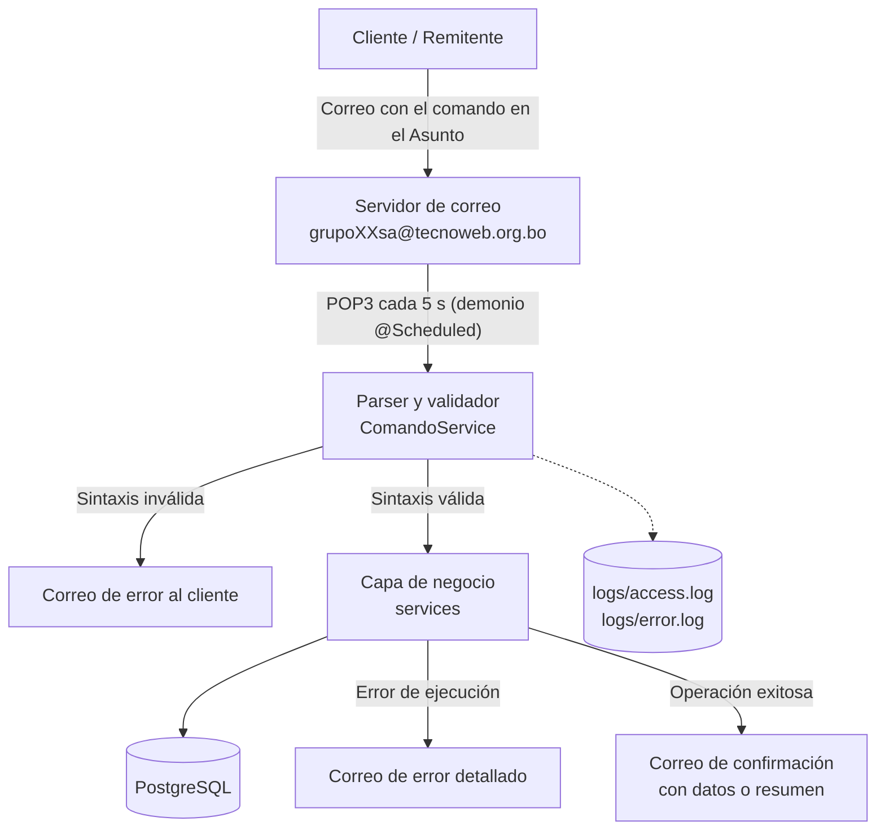
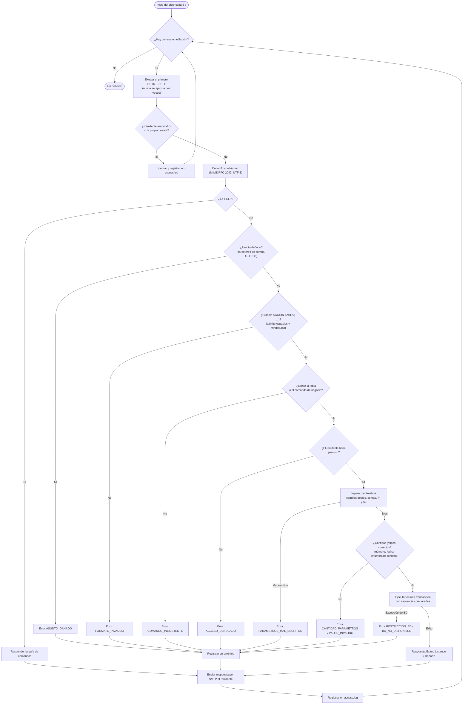
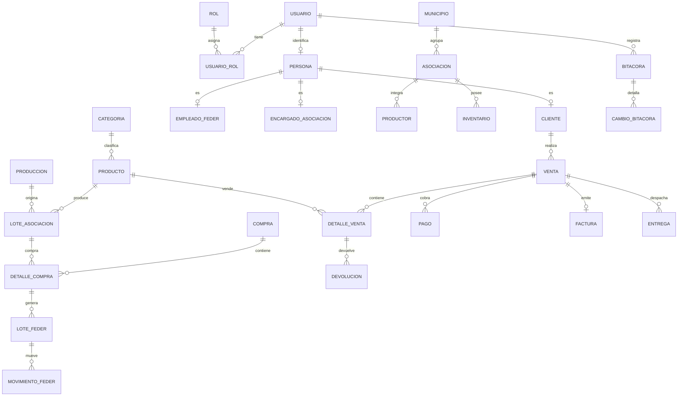

# Correo-2-2026: sistema de comandos por correo electrónico

Backend con **arquitectura dirigida por correo** (Email-Driven) para la gestión de la Federación (FEDER): asociaciones, productores, lotes, inventarios, ventas, pagos y reportes. El cliente no usa una página web. Envía un correo cuyo **Asunto** es un comando, por ejemplo `LISPER["*"]`. El sistema lo valida, lo ejecuta contra PostgreSQL y le responde por correo con el resultado o con el detalle del error.

Proyecto #1 de la materia INF513 (Tecnología Web).

| Componente | Tecnología |
|---|---|
| Lenguaje | Java 21 |
| Framework | Spring Boot 4.1 (Spring Data JPA / Hibernate, Spring Mail, `@Scheduled`) |
| Base de datos | PostgreSQL (`db.tecnoweb.org.bo`) |
| Correo | POP3 para leer, SMTP para responder (`mail.tecnoweb.org.bo`; opcionalmente Gmail para pruebas) |
| Reportes | PDF (OpenPDF) y Excel (Apache POI) adjuntos al correo |
| Pruebas | JUnit 5, Mockito, PostgreSQL embebido (zonky) |

---

## 1. Arquitectura

### Flujo operativo



### Capas

El correo es la interfaz de usuario, así que la capa de presentación lee y escribe correos en vez de páginas web.

```text
Correo entrante
    │
    ▼
presentation   CorreoService (POP3/SMTP) → ComandoService (parser) → Presentador* (HTML, PDF, Excel)
    │
    ▼
service        permisos, validación de tipos, CRUD, casos de uso, transacciones
    │
    ▼
repository     consultas JPA parametrizadas, bloqueos
    │
    ▼
PostgreSQL
```

| Paquete | Responsabilidad |
|---|---|
| `presentation` | Leer el buzón, interpretar el asunto, armar la respuesta (texto + HTML + adjuntos) y enviarla |
| `service` | Permisos por rol, validación de tipos, reglas de negocio y transacciones |
| `repository` | Acceso a datos con JPA; ninguna consulta se arma concatenando texto del usuario |
| `entity`, `dto` | Modelo persistente y resultados independientes del correo |
| `infrastructure` | Integración externa (pasarela de pagos PagoFácil) |
| `config` | Arranque, activación del demonio de lectura |

`ArquitecturaCapasTest` comprueba en cada compilación que se respeten estas dependencias. El detalle está en [ARQUITECTURA.md](ARQUITECTURA.md).

---

## 2. Diagrama de flujo del analizador de correos

Cada 5 segundos `CorreoService.revisarBuzon()` abre una sesión POP3 y atiende los correos uno por uno:



### Reglas de sintaxis

| Regla | Ejemplo válido |
|---|---|
| Forma: `ACCIÓN` (3 letras) + `TABLA` (3 letras) + `[parámetros]` | `LISPER["*"]` |
| Cada parámetro entre comillas dobles rectas, separados por coma | `INSCAT["Fruta fresca","Frutas"]` |
| Espacios extra permitidos (también el espacio duro U+00A0) | `INSCAT [ "Fruta fresca" , "Frutas" ]` |
| El comando puede ir en minúsculas | `inscat["Fruta fresca","Frutas"]` |
| Comilla dentro de un dato: `\"`; barra invertida: `\\` | `INSCAT["Jugo \"natural\"","Bebidas"]` |
| Caracteres UTF-8 (tildes, ñ) | `INSCAT["Café y maní","Señal"]` |

Acciones CRUD: `LIS` (listar, `"*"` o un ID), `INS` (insertar), `MOD` (modificar: ID + campos; `""` no cambia el campo), `DEL` (eliminar; baja lógica si la tabla tiene `activo`). Además hay comandos de negocio (ventas, pagos con QR, lotes, reportes PDF/Excel). La referencia completa, con los parámetros de cada tabla y los códigos de error, está en [COMANDOS.md](COMANDOS.md). Un correo con el asunto `HELP` devuelve la misma guía.

### Ejemplos de respuesta

| Asunto enviado | Asunto de la respuesta | Cuerpo |
|---|---|---|
| `LISPER["*"]` | `Listando Persona` | Tabla con los registros |
| `INSCAT["Fruta fresca","Frutas"]` | `Exito` | `Registro creado con id 12.` |
| `INSCAT["solo uno"]` | `Error 501 5.5.4` | `Codigo: 501 5.5.4 CANTIDAD_PARAMETROS` y la lista de parámetros esperados |
| `INSROL["d","ADMINISTRADOR"]` | `Error 554 5.0.0` | `Codigo: 554 5.0.0 RESTRICCION_BD` y `Detalle: Ya existe un registro con esos datos.` |

---

## 3. Estructura de la base de datos

El esquema completo está en [db.sql](db.sql): 36 tablas, con claves primarias `GENERATED ALWAYS AS IDENTITY`. Las restricciones (UNIQUE, CHECK, claves foráneas adicionales) y los roles iniciales están en [restricciones.sql](restricciones.sql). [datos_prueba.sql](datos_prueba.sql) carga datos de ejemplo.

| Módulo | Tablas (código del comando) |
|---|---|
| Usuarios y seguridad | Usuario (`USU`), Rol (`ROL`), Usuario_rol (`URO`), Persona (`PER`), Bitacora (`BIT`), Cambio_bitacora (`CAB`) |
| Organización | Municipio (`MUN`), Asociacion (`ASO`), Encargado_asociacion (`ENC`), Productor (`PTR`), Empleado_feder (`EMP`), Ubicacion (`UBI`) |
| Producción y lotes | Produccion (`PRD`), Lote_asociacion (`LOA`), Oferta_asociacion (`OFE`), Compra (`COM`), Detalle_compra (`DCO`), Lote_feder (`LOF`) |
| Catálogo e inventario | Categoria (`CAT`), Producto (`PRO`), Inventario (`INV`), Movimiento_inventario (`MOI`), Movimiento_feder (`MOF`), Alerta_stock (`ALE`), Reserva_stock (`RES`) |
| Ventas | Cliente (`CLI`), Item_carrito (`CAR`), Venta (`VEN`), Detalle_venta (`DVE`), Historial_estado_venta (`HIS`), Pago (`PAG`), Factura (`FAC`), Entrega (`ENT`), Devolucion (`DEV`), Notificacion (`NOT`) |
| Análisis | Indicador_financiero (`IND`) |

### Relaciones principales



Tabla `persona` (consultada en el ejemplo `LISPER["*"]`):

| Columna | Tipo | Restricción |
|---|---|---|
| PersonaID | INTEGER | PK, identidad |
| Ci | VARCHAR(20) | UNIQUE |
| Nombre | VARCHAR(150) | |
| Apellido | VARCHAR(150) | |
| Telefono | VARCHAR(20) | |
| UsuarioID | INTEGER | FK → Usuario, UNIQUE |

---

## 4. Seguridad

- **Sentencias preparadas.** Todo acceso a datos pasa por JPA/Hibernate con parámetros enlazados (`setParameter`, Spring Data). Ningún valor recibido por correo se concatena en SQL.
- **Validación estricta de tipos en el servidor**, antes de llegar a la base: enteros, decimales (escala), fechas `yyyy-MM-dd` y `yyyy-MM-dd HH:mm`, booleanos, enumerados, longitud máxima de cada columna y existencia de las relaciones.
- **Permisos por remitente.** Cada orden se autoriza según los roles de la cuenta asociada al correo del remitente (`ADMINISTRADOR`, `PERSONAL`, cliente, productor, etc.). Las tablas históricas solo admiten `LIS`.
- **Contraseñas.** `USU` guarda la contraseña con hash, nunca la muestra en `LISUSU` y la oculta en la terminal y en los logs (`MODUSU[***]`).
- **Credenciales fuera del código.** Viven en `.env`, que está en `.gitignore`. El repositorio solo incluye la plantilla `.env.example`.
- **Transacciones.** Cada comando corre en una transacción junto con su registro de auditoría en `BIT`/`CAB`; si algo falla, no queda nada a medias.

---

## 5. Logs y auditoría

Configurados en [logback-spring.xml](src/main/resources/logback-spring.xml). Por defecto se escriben en la carpeta `logs/`, que se cambia con `APP_LOG_DIR`. Rotan por día o al llegar a 10 MB, y se conservan 30 días.

| Archivo | Contenido |
|---|---|
| `logs/access.log` | Una línea por cada correo procesado: remitente, comando, resultado y si la respuesta se envió |
| `logs/error.log` | Cada comando rechazado (código y detalle), cada excepción capturada con su traza completa, fallos de POP3/SMTP y cualquier `ERROR` del sistema |

```text
# access.log
2026-11-13 20:22:01.060 | de=cliente@uagrm.edu.bo | comando=LISCAT | resultado=Listando Categoria | respuesta enviada
2026-11-13 20:22:01.066 | de=cliente@uagrm.edu.bo | comando=LISXXX | resultado=Error 500 5.5.1 | respuesta enviada

# error.log
2026-11-13 20:22:01.066 | ERROR | error | de=cliente@uagrm.edu.bo | asunto=LISXXX["*"] | Error 500 5.5.1 | Codigo: 500 5.5.1 COMANDO_INEXISTENTE / Detalle: El comando LISXXX no existe ...
2026-11-13 20:22:01.090 | ERROR | error | Excepcion al ejecutar [RESTRICCION_BD] SQLSTATE 23505
org.springframework.dao.DataIntegrityViolationException: ...
```

La consola muestra además la traza del protocolo (`S :` / `C :`) de cada sesión POP3 y SMTP.

---

## 6. Instalación y configuración

### Requisitos

- JDK 21
- Acceso a PostgreSQL y a una cuenta de correo con POP3 y SMTP (la de la cátedra o una de Gmail para pruebas)
- No hace falta instalar Maven: se incluye el wrapper (`mvnw` / `mvnw.cmd`)

### Pasos

1. **Clonar el repositorio**

   ```bash
   git clone https://github.com/andres345f/Correo-2-2026.git
   cd Correo-2-2026
   ```

2. **Crear la base de datos.** En una base vacía, ejecutar en este orden:

   ```bash
   psql -h db.tecnoweb.org.bo -U grupoXXsa -d db_grupoXXsa -f db.sql            # borra y crea las tablas
   psql -h db.tecnoweb.org.bo -U grupoXXsa -d db_grupoXXsa -f restricciones.sql # reglas y roles
   psql -h db.tecnoweb.org.bo -U grupoXXsa -d db_grupoXXsa -f datos_prueba.sql  # opcional
   ```

3. **Configurar las credenciales.** Copiar la plantilla y completarla:

   ```bash
   cp .env.example .env
   ```

   | Clave | Descripción |
   |---|---|
   | `DB_URL`, `DB_USERNAME`, `DB_PASSWORD` | Conexión a PostgreSQL |
   | `MAIL_HOST`, `MAIL_USERNAME`, `MAIL_PASSWORD` | Buzón POP3 que recibe los comandos |
   | `MAIL_FROM` | Dirección que firma las respuestas (`grupoXXsa@tecnoweb.org.bo`) |
   | `APP_ADMIN_CORREO` | Correo que actúa como administrador inicial, para crear las primeras cuentas |
   | `SMTP_PROVEEDOR`, `POP_PROVEEDOR` | `TECNOWEB` (por defecto) o `GOOGLE` |
   | `SMTP_GMAIL_USER`, `SMTP_GMAIL_APP_PASSWORD` | Solo si se usa Gmail |
   | `PAGOFACIL_*` | Solo para los comandos de pago con QR |
   | `APP_LOG_DIR` | Carpeta de los logs (por defecto `logs`) |

   Una variable de entorno del sistema con el mismo nombre tiene prioridad sobre el `.env`.

4. **Compilar y ejecutar**

   ```bash
   ./mvnw spring-boot:run              # Linux / macOS
   .\mvnw.cmd spring-boot:run          # Windows
   ```

   Al arrancar, la consola informa qué base y qué buzón están conectados. Desde ese momento el demonio revisa el buzón cada 5 segundos.

### Despliegue en el servidor

```bash
./mvnw clean package -DskipTests
nohup java -jar target/correo-0.0.1-SNAPSHOT.jar > consola.out 2>&1 &
```

El proceso queda en segundo plano revisando el buzón. No necesita cron, porque la periodicidad la da `@Scheduled`. Para detenerlo: `kill <pid>`.

### Primer uso

1. Desde la dirección configurada en `APP_ADMIN_CORREO`, enviar un correo a `grupoXXsa@tecnoweb.org.bo` con el asunto `HELP`.
2. Crear cuentas con `INSUSU["correo@dominio","contraseña"]` y asignar roles con `INSURO["idUsuario","idRol"]`.
3. Probar `LISPER["*"]`.

---

## 7. Pruebas

```powershell
.\mvnw.cmd clean '-Dtest=!ConexionBaseDatosTest,!CorreoApplicationTests' test
```

Usan un PostgreSQL embebido con `db.sql` y `restricciones.sql`, y servidores POP3/SMTP simulados en `localhost`. No tocan la base ni el buzón reales. Las dos clases excluidas se conectan a la base configurada en `.env`.

| Clase | Qué verifica |
|---|---|
| `ComandoServiceTest` | Sintaxis (espacios, minúsculas, `\"`, UTF-8), errores de formato, cantidad y tipos, CRUD completo |
| `MimeCorreoTest` | Lectura POP3, decodificación MIME, respuestas HTML y adjuntos, que no se repita una orden |
| `RegistrosLogTest` | Que `access.log` y `error.log` registren cada correo y error, sin contraseñas |
| `PermisosTest` | Autorización por rol |
| `FlujoGuiaTest` | Casos de uso de negocio de punta a punta |
| `ArquitecturaCapasTest` | Dependencias permitidas entre capas |
| `ClienteSmtpTest`, `PagoFacilGatewayTest`, `AyudaYRespuestasTest`, `EstadoInicialTest` | Envío, pasarela de pagos, guía HELP, arranque |

---

## 8. Estructura del repositorio

```text
.
├── db.sql                  Esquema de la base (crea las 36 tablas)
├── restricciones.sql       UNIQUE, CHECK y roles iniciales
├── datos_prueba.sql        Datos de ejemplo
├── .env.example            Plantilla de configuración (el .env real no se sube)
├── ARQUITECTURA.md         Detalle de las capas y sus límites
├── COMANDOS.md             Referencia completa de comandos y códigos de error
├── pom.xml                 Dependencias Maven
└── src
    ├── main/java/com/example/correo
    │   ├── presentation    CorreoService, ComandoService, ClientePop3, ClienteSmtp, presentadores
    │   ├── service         Permisos, CRUD, ventas, lotes, inventario, cobros, reportes
    │   ├── repository      Acceso a datos JPA
    │   ├── entity, dto     Modelo y resultados
    │   ├── infrastructure  PagoFacilGateway
    │   └── config          Arranque y demonio de lectura
    ├── main/resources      application.properties, logback-spring.xml
    └── test                Pruebas automáticas
```
